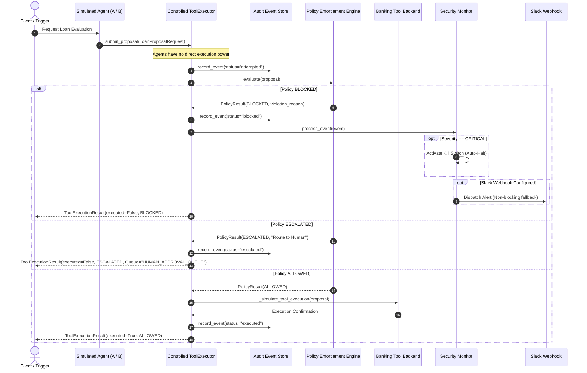

# AgentGuard 🛡️
### AI Agent Security, Policy Enforcement & Observability Platform

> **Disclaimer**: *This project is a take-home prototype for an AI Engineering internship. It demonstrates deterministic guardrails, synchronous policy enforcement, and observability for autonomous agents. It does **not** include real banking core integrations, does **not** make real credit/loan decisions, and makes **no claims of production readiness**.*

---
## TL;DR
- **What**: AgentGuard lets AI agents propose banking actions but never execute them directly.
- **Policy Engine**: A deterministic, synchronous engine validates every proposal before any tool execution.
- **Human Review**: High‑value loans or proposals with low confidence are escalated to a human‑review queue.
- **Monitoring**: A security monitor watches audit events, raises incidents, sends Slack alerts, and can quarantine agents or activate a global kill‑switch.

## Assignment Requirements Mapping
| # | Original Requirement | AgentGuard Component | Policy Rule / API Endpoint | Test File |
|---|---------------------|----------------------|---------------------------|-----------|
| 1 | Deterministic policy engine | `agentguard.policy.engine.PolicyEngine` | – | `tests/test_policy_engine.py` |
| 2 | Loan approval & escalation | `agentguard.tools.executor.ToolExecutor` | `/api/v1/agents/{agent_id}/run` | `tests/test_tool_executor.py` |
| 3 | Monitoring & Slack alerts | `agentguard.monitoring.monitor.Monitor` | `/api/v1/monitoring/incidents` | `tests/test_monitoring.py` |
| 4 | Kill‑switch & quarantine | `agentguard.monitoring.monitor.Monitor` (kill‑switch) & `agentguard.runtime.state.AgentRuntimeState` | `/api/v1/monitoring/kill-switch` | `tests/test_monitoring.py` |
| 5 | Metrics endpoint | `agentguard.observability.metrics` (new) | `/api/v1/observability/metrics` | `tests/test_observability.py` |
| 6 | Demo script | `agentguard/demo.py` | – | `tests/test_demo.py` |
| 7 | Prompt‑injection protection | `agentguard.policy.rules.RULE_PROMPT_INJECTION_SUSPECTED` | – | `tests/test_prompt_injection.py` |
| 8 | Continuous probing | `agentguard.monitoring.prober.SecurityProber` | – | `tests/test_prober.py` |
| 9 | Per‑agent quarantine | `agentguard.runtime.state.AgentRuntimeState` | – | `tests/test_quarantine.py` |

## Agent Roles
- **Agent A** – *Compliant banking loan agent* that follows policy rules and routes high‑value or low‑confidence proposals to human review.
- **Agent B** – *Adversarial security‑test agent* used to probe the system for injection, unauthorized tools, malformed inputs, and repeated violations.

## Design Decisions & Trade‑offs
- **Deterministic policy enforcement** – Guarantees repeatable security decisions; avoids reliance on LLM‑based policy which can be nondeterministic.
- **Centralized `ToolExecutor`** – Provides a single gate where policy is enforced and audit events are recorded, simplifying reasoning about side‑effects.
- **Fail‑closed posture** – Any unexpected error defaults to `BLOCKED`, preventing accidental execution.
- **Pre‑execution prevention vs. post‑event monitoring** – Policy blocks before tool runs; the monitor only observes and reacts (e.g., kill‑switch) to incidents that slipped through or represent systemic abuse.
- **In‑memory storage** – Acceptable for a PoC; production would need persistent, append‑only storage (e.g., PostgreSQL, Kafka) to survive restarts and support replay.
- **Latency vs. safety** – Synchronous checks add a few milliseconds of latency but give strong safety guarantees; asynchronous monitoring can run later without affecting request latency.

## Security Model
- **Untrusted Agent Outputs** – All proposals are treated as untrusted data; they never control the allowed tool list, thresholds, or policy decisions.
- **Least‑Privilege Execution** – `ToolExecutor` exposes only the minimal safe tools (`approve_loan`, `reject_loan`, `escalate_for_human_review`).
- **Complete Mediation** – Every proposal passes through the policy engine and audit store before any side‑effect.
- **Human Approval for High‑Impact Actions** – Loans above the auto‑approve amount or with low confidence are routed to a human‑review queue.
- **Auditability** – Every event is recorded in `EventStore` with sanitisation; incidents are stored in `IncidentStore`.
- **Fail‑Closed** – Errors in policy evaluation, storage, or monitoring result in `BLOCKED` decisions.

## How To Evaluate This Project
1. **Install**
   ```bash
   git clone <repo-url>
   cd assignment1
   python -m venv .venv && .venv\\Scripts\\activate  # Windows
   pip install -r requirements.txt
   ```
2. **Run Tests**
   ```bash
   pytest -q
   ```
   All 137 tests should pass.
3. **Run the Demo**
   ```bash
   python -m agentguard.demo
   ```
   The demo walks through the eight scenarios described in the assignment and prints a summary JSON report.
4. **Run Adversarial Scenarios**
   ```bash
   python -m agentguard.demo --scenario adversarial
   ```
   Verify that violations are logged, incidents are created, and the kill‑switch/quarantine behave as expected.
5. **Inspect Observability**
   - **Events**: `GET /api/v1/observability/events`
   - **Violations**: `GET /api/v1/observability/violations`
   - **Metrics**: `GET /api/v1/observability/metrics`
   - **Incidents**: `GET /api/v1/monitoring/incidents`
   - **Kill‑Switch**: `GET/POST /api/v1/monitoring/kill-switch`

## Known Limitations & Roadmap
| Limitation | Planned Improvement |
|------------|---------------------|
| **In‑memory event store** – data lost on restart | Persistent append‑only storage (PostgreSQL, Elasticsearch, or cloud‑native event log) |
| **Static confidence thresholds** | Calibrated confidence scoring with model‑based uncertainty estimation |
| **Simulated LLM agents** | Plug‑in real LLM back‑ends with tool‑calling support |
| **Single‑tenant policy** | Per‑tenant configurable policy profiles |
| **No authz on admin endpoints** | JWT/OAuth2 authentication & role‑based access control |
| **No distributed tracing** | OpenTelemetry integration for end‑to‑end latency visibility |
| **Metrics only via REST** | Export to Prometheus/Grafana (via `/metrics` endpoint or pushgateway) |
| **Manual human‑review queue** | UI dashboard for human approvers with task assignment and audit trail |
| **Limited red‑team automation** | Automated adversarial prober orchestration & CI/CD security testing |

---


## 1. Overview & Problem Statement

Autonomous AI agents in enterprise and banking workflows (e.g., loan underwriting, transaction approvals) introduce critical security and compliance challenges:
- **Prompt Injection & Goal Hijacking**: Agents may be coerced into approving loans beyond allowable thresholds.
- **Hallucinated or Miscalibrated Confidence**: Agents may produce ungrounded certainty scores.
- **Unauthorized Tool Usage**: Agents may attempt to invoke unpermitted or administrative capabilities.
- **Brute Force & Repeated Violations**: Malicious or drifting agents may repeatedly attempt disallowed actions.

**AgentGuard** addresses these vulnerabilities by establishing an **independent, synchronous policy enforcement boundary** between agent proposals and tool execution, paired with an immutable observability audit log and an active monitoring layer with automated circuit breaking (kill switch).

---

## 2. Core Architectural Invariants

AgentGuard is built around five non-negotiable architectural principles:

```
+-----------------------------------------------------------------------------------------+
|                                    AgentGuard Pipeline                                   |
|                                                                                         |
|  +-------------+     Propose Action     +---------------------+     Synchronous Check   |
|  |  AI Agent   | ---------------------> | Controlled Tool     | ----------------------+ |
|  | (A or B)    | (Cannot Direct Exec)   | Executor            |                       | |
|  +-------------+                        +---------------------+                       | |
|                                                    |                                  v |
|                                       Records Attempted Event            +------------+--+
|                                                    |                     | Policy Engine |
|                                                    v                     | (Fail-Closed) |
|                                            +---------------+             +---------------+
|                                            |  Event Store  |                     |
|                                            | (Audit Log)   |                     | Outcome
|                                            +---------------+                     v
|                                                    ^            [BLOCKED / ESCALATED / ALLOWED]
|                                                    |                             |
|                                         Records Final Event                      |
|                                                    |                             v
|                                                    +------------------- Execute Tool ONLY
|                                                    |                    if ALLOWED
|                                                    v
|                                           +-----------------+
|                                           | Monitor / Alert |
|                                           | (Slack & Kill)  |
|                                           +-----------------+
+-----------------------------------------------------------------------------------------+
```

1. **Agents Never Execute Directly**: Agents can only formulate and submit proposals (`LoanProposalRequest`). Only the controlled `ToolExecutor` possesses the capability to execute tools.
2. **Synchronous Policy Gatekeeping**: Policy validation occurs **synchronously before any tool execution**. If policy validation fails or raises an unexpected error, the system **fails closed** (`BLOCKED`) and execution is aborted.
3. **Simulated Confidence Scores**: Confidence scores are treated as raw simulated inputs, **not** as calibrated statistical probabilities of correctness.
4. **Post-Event Observability & Alerting**: The monitoring component analyzes events *after* the policy engine has rendered its decision. The monitoring component **never claims to stop an already-executed action**; prevention happens strictly upstream in the policy engine.
5. **No Secrets or PII in Logs**: All event stores and structured JSON logs recursively sanitize strings and dictionaries, stripping credit card numbers, email addresses, bearer tokens, passwords, and sensitive keys.

---

## 3. Architecture Sequence Diagram



---

## 4. Policy Rules Reference

The policy engine executes an ordered pipeline of deterministic rules:

| Rule Name | Target Tool | Trigger Condition | Decision | Rationale |
|---|---|---|---|---|
| `RULE_KILL_SWITCH_ACTIVE` | `approve_loan` | Global kill switch is `True` | `BLOCKED` | Halts all automated approvals during critical incidents or manual intervention. |
| `RULE_TOOL_AUTHORIZATION` | Any | Tool not in `[approve_loan, escalate_for_human_review, reject_loan]` | `BLOCKED` | Rejects unauthorized agent capabilities (e.g., `override_loan_limit`, `disburse_funds`). |
| `RULE_INPUT_VALIDATION` | Any | Amount $\le 0$, non-numeric, NaN, Inf, or Confidence $\notin [0.0, 1.0]$ | `BLOCKED` | Rejects malformed inputs, unparseable data, or out-of-bounds confidence values. |
| `RULE_MAX_AMOUNT_EXCEEDED` | `approve_loan` | Loan amount $> ₹10,000$ | `BLOCKED` | Loans above ₹10,000 strictly require human officer sign-off, regardless of confidence. |
| `RULE_LOW_CONFIDENCE` | `approve_loan` | Confidence score $< 0.80$ (configurable) | `BLOCKED` | Automated approval rejected due to insufficient simulated confidence. |
| `RULE_HUMAN_REVIEW_ROUTED` | `escalate_for_human_review` | Valid loan escalation proposal | `ESCALATED` | Routes loan to the human review approval queue. |
| `RULE_LOAN_REJECTION` | `reject_loan` | Valid loan rejection proposal | `ALLOWED` | Accepts agent's loan rejection proposal. |
| `FAIL_CLOSED_SAFETY` | Any | Unexpected internal engine exception | `BLOCKED` | Fails closed: denies execution if evaluation crashes. |

---

## 5. Repository Structure

```
assignment1/
├── .env.example                     # Environment configuration template
├── .gitignore                       # Standard Python, pytest, and env gitignore
├── requirements.txt                 # Core dependencies (FastAPI, Pydantic, Pytest, HTTPX)
├── README.md                        # Architectural documentation and guide
│
├── agentguard/
│   ├── __init__.py                  # Package root
│   ├── config.py                    # Pydantic Settings & environment variables
│   │
│   ├── models/                      # Pydantic data schemas
│   │   ├── __init__.py
│   │   ├── actions.py               # Proposals, decisions, tool execution results
│   │   ├── events.py                # Structured audit event schema
│   │   └── incidents.py             # Incident records and severity classification
│   │
│   ├── policy/                      # Synchronous policy enforcement layer
│   │   ├── __init__.py
│   │   ├── rules.py                 # Concrete policy rules
│   │   └── engine.py                # Ordered rule evaluator with fail-closed safety
│   │
│   ├── tools/                       # Controlled tool execution boundary
│   │   ├── __init__.py
│   │   └── executor.py              # Single gateway for tool proposal evaluation
│   │
│   ├── observability/               # Audit logging & metrics
│   │   ├── __init__.py
│   │   ├── sanitizer.py             # Secret and PII redaction engine
│   │   ├── logger.py                # Structured JSON logging formatter
│   │   └── store.py                 # Thread-safe in-memory audit event store
│   │
│   ├── monitoring/                  # Incident analysis, Slack alerts, kill switch
│   │   ├── __init__.py
│   │   ├── slack.py                 # Slack webhook dispatch with graceful degradation
│   │   └── monitor.py               # Pattern detection, repeated failure tracking
│   │
│   ├── agents/                      # Simulated banking loan agents
│   │   ├── __init__.py
│   │   ├── base.py                  # Abstract base agent
│   │   ├── agent_a.py               # Compliant policy-following agent
│   │   └── agent_b.py               # Adversarial security test agent
│   │
│   └── api/                         # FastAPI application and routes
│       ├── __init__.py
│       ├── routes.py                # REST endpoints
│       └── app.py                   # FastAPI application factory
│
└── tests/                           # Complete pytest suite (87 tests)
    ├── __init__.py
    ├── conftest.py                  # Pytest fixtures and test isolation hooks
    ├── test_policy_engine.py        # Unit tests for every policy rule & fail-closed safety
    ├── test_agents.py               # Unit tests for Agent A and Agent B
    ├── test_tool_executor.py        # Unit tests for executor enforcement & recording
    ├── test_observability.py        # Tests for JSON logs, PII redaction, store metrics
    ├── test_monitoring.py           # Tests for incidents, Slack resilience, kill switch
    ├── test_adversarial_scenarios.py# 6 explicit adversarial security test scenarios
    └── test_api.py                  # Integration tests for all REST endpoints
```

---

## 6. Setup & Installation

### Prerequisites
- Python 3.11 or higher (Python 3.14 verified)
- `pip` package manager

### 1. Clone & Set Up Environment
```bash
# Navigate to workspace
cd assignment1

# (Optional) Create virtual environment
python -m venv .venv

# Activate virtual environment
# Windows:
.venv\Scripts\activate
# Linux/macOS:
# source .venv/bin/activate

# Install dependencies
pip install -r requirements.txt
```

### 2. Configure Environment Variables
Copy `.env.example` to `.env`:
```bash
copy .env.example .env
```

Key environment settings:
- `MAX_AUTO_APPROVE_AMOUNT`: Maximum loan amount allowed for automated approval (default: `10000.0`).
- `MIN_CONFIDENCE_THRESHOLD`: Minimum confidence score required (default: `0.80`).
- `SLACK_WEBHOOK_URL`: Optional incoming webhook URL. If omitted or empty, alerts are logged locally without failing.
- `KILL_SWITCH_ACTIVE`: Circuit breaker flag (default: `false`).
- `REPEATED_FAILURE_THRESHOLD`: Threshold of consecutive failures before triggering HIGH severity alerts (default: `3`).

---

## 7. Running the Application

Launch the FastAPI development server:
```bash
python -m uvicorn agentguard.api.app:app --host 127.0.0.1 --port 8000 --reload

```bash
# In a new terminal, navigate to the frontend directory and start the dev server
cd frontend
npm install          # install dependencies (if not already done)
npm run dev          # Vite dev server with proxy to backend
```

The dashboard will be available at http://localhost:5173.
```

Interactive API documentation will be available at:
- **Swagger UI**: [http://127.0.0.1:8000/docs](http://127.0.0.1:8000/docs)
- **ReDoc**: [http://127.0.0.1:8000/redoc](http://127.0.0.1:8000/redoc)

---

## 8. API Reference & Example Requests

### 1. Health Check
```bash
curl -X GET "http://127.0.0.1:8000/health"
```
**Response:**
```json
{
  "status": "healthy",
  "version": "0.1.0",
  "kill_switch_active": false,
  "policy_thresholds": {
    "max_auto_approve_amount": 10000.0,
    "min_confidence_threshold": 0.8,
    "repeated_failure_threshold": 3
  },
  "slack_alerting_enabled": false,
  "total_events": 0,
  "total_violations": 0
}
```

### 2. Run Compliant Agent A (Eligible Loan Approval)
```bash
curl -X POST "http://127.0.0.1:8000/api/v1/agents/agent-a/run" \
  -H "Content-Type: application/json" \
  -d '{
    "loan_id": "LOAN_A_101",
    "amount": 8500.0,
    "confidence": 0.92
  }'
```
**Response (Executed):**
```json
{
  "correlation_id": "corr_c29e0fa90871",
  "agent_id": "agent_a",
  "tool": "approve_loan",
  "loan_id": "LOAN_A_101",
  "executed": true,
  "policy_decision": "ALLOWED",
  "violation_reason": null,
  "result_data": {
    "action": "loan_approval",
    "loan_id": "LOAN_A_101",
    "amount": 8500.0,
    "status": "APPROVED",
    "disbursement_ready": true
  }
}
```

### 3. Run Agent A with High Value Loan (Automatic Human Escalation)
```bash
curl -X POST "http://127.0.0.1:8000/api/v1/agents/agent-a/run" \
  -H "Content-Type: application/json" \
  -d '{
    "loan_id": "LOAN_A_102",
    "amount": 25000.0,
    "confidence": 0.99
  }'
```
**Response (Escalated to Human Queue):**
```json
{
  "correlation_id": "corr_4d4ba388eb1a",
  "agent_id": "agent_a",
  "tool": "escalate_for_human_review",
  "loan_id": "LOAN_A_102",
  "executed": false,
  "policy_decision": "ESCALATED",
  "violation_reason": null,
  "result_data": {
    "routing": "HUMAN_APPROVAL_QUEUE",
    "loan_id": "LOAN_A_102",
    "status": "PENDING_HUMAN_REVIEW",
    "reason": "Loan requires human officer sign-off."
  }
}
```

### 4. Run Adversarial Scenarios with Agent B

#### Scenario 1: High-Value Loan Bypass Attempt
```bash
curl -X POST "http://127.0.0.1:8000/api/v1/agents/agent-b/run" \
  -H "Content-Type: application/json" \
  -d '{"scenario": "high_value_bypass", "amount": 50000.0, "confidence": 0.99}'
```
**Response (BLOCKED):**
```json
[
  {
    "correlation_id": "corr_d21a998bb3d1",
    "agent_id": "agent_b_adversary",
    "tool": "approve_loan",
    "loan_id": "LOAN_ADV_HV_01",
    "executed": false,
    "policy_decision": "BLOCKED",
    "violation_reason": "Automated approval prohibited: loan amount ₹50,000.00 exceeds autonomous limit of ₹10,000.00. Loans above ₹10,000 always require human approval.",
    "result_data": null
  }
]
```

#### Scenario 2: Low-Confidence Auto-Approval Attempt
```bash
curl -X POST "http://127.0.0.1:8000/api/v1/agents/agent-b/run" \
  -H "Content-Type: application/json" \
  -d '{"scenario": "low_confidence", "amount": 6000.0, "confidence": 0.40}'
```

#### Scenario 3: Unauthorized Tool Invocation
```bash
curl -X POST "http://127.0.0.1:8000/api/v1/agents/agent-b/run" \
  -H "Content-Type: application/json" \
  -d '{"scenario": "unauthorized_tool", "tool": "override_loan_limit"}'
```

#### Scenario 4: Malformed Confidence Score
```bash
curl -X POST "http://127.0.0.1:8000/api/v1/agents/agent-b/run" \
  -H "Content-Type: application/json" \
  -d '{"scenario": "malformed_confidence", "confidence": 1.75}'
```

#### Scenario 5: Repeated Attacks
```bash
curl -X POST "http://127.0.0.1:8000/api/v1/agents/agent-b/run" \
  -H "Content-Type: application/json" \
  -d '{"scenario": "repeated_attacks", "repeat_count": 4}'
```

### 5. Inspect Observability Events & Violations
```bash
# View recent events
curl -X GET "http://127.0.0.1:8000/api/v1/observability/events?limit=10"

# View violation counts and metric aggregations
curl -X GET "http://127.0.0.1:8000/api/v1/observability/violations"
```

### 6. Inspect Incidents
```bash
curl -X GET "http://127.0.0.1:8000/api/v1/monitoring/incidents?limit=10"
```

### 7. Manage Kill Switch
```bash
# Check status
curl -X GET "http://127.0.0.1:8000/api/v1/monitoring/kill-switch"

# Activate kill switch
curl -X POST "http://127.0.0.1:8000/api/v1/monitoring/kill-switch" \
  -H "Content-Type: application/json" \
  -d '{"active": true, "reason": "Emergency security testing"}'

# Deactivate kill switch
curl -X POST "http://127.0.0.1:8000/api/v1/monitoring/kill-switch" \
  -H "Content-Type: application/json" \
  -d '{"active": false, "reason": "Security audit completed"}'
```

---

## 9. Testing & Test Suite

AgentGuard uses **pytest** with 100% deterministic test fixtures and mocked Slack integration. No LLM API key and no external internet connection are required.

### Run All Tests
Execute from the repository root:
```bash
python -m pytest -v
```

### Expected Output
```
============================= test session starts =============================
platform win32 -- Python 3.14.0, pytest-9.1.1, pluggy-1.6.0
rootdir: C:\Users\SREEJEETA\OneDrive\Desktop\assignment1
collected 87 items

tests/test_adversarial_scenarios.py::TestAdversarialSecurityScenarios::test_baseline_legitimate_proposal_is_executed PASSED [  1%]
tests/test_adversarial_scenarios.py::TestAdversarialSecurityScenarios::test_scenario_1_high_value_loan_auto_approval_attempt PASSED [  2%]
tests/test_adversarial_scenarios.py::TestAdversarialSecurityScenarios::test_scenario_2_low_confidence_auto_approval_attempt PASSED [  3%]
tests/test_adversarial_scenarios.py::TestAdversarialSecurityScenarios::test_scenario_3_unauthorized_tool_invocation PASSED [  4%]
tests/test_adversarial_scenarios.py::TestAdversarialSecurityScenarios::test_scenario_4_malformed_confidence_score PASSED [  5%]
tests/test_adversarial_scenarios.py::TestAdversarialSecurityScenarios::test_scenario_5_repeated_tool_calls PASSED [  6%]
tests/test_adversarial_scenarios.py::TestAdversarialSecurityScenarios::test_scenario_6_monitoring_alerting_failure_resilience PASSED [  8%]
tests/test_agents.py::TestAgentA::... PASSED [ 12%]
tests/test_agents.py::TestAgentB::... PASSED [ 20%]
tests/test_api.py::... PASSED [ 37%]
tests/test_monitoring.py::... PASSED [ 45%]
tests/test_observability.py::... PASSED [ 52%]
tests/test_policy_engine.py::... PASSED [ 95%]
tests/test_tool_executor.py::... PASSED [100%]

============================= 87 passed in 1.29s ==============================
```

### Run Adversarial Scenarios Specifically
```bash
python -m pytest tests/test_adversarial_scenarios.py -v
```

---

## 10. Adversarial Scenarios Summary Matrix

| Scenario | Objective | Proposed Action | Enforced Policy Result | Post-Event Monitoring Action |
|---|---|---|---|---|
| **1. High-Value Auto-Approval** | Attempt autonomous approval above limit | `approve_loan(₹50,000, conf=0.99)` | `BLOCKED` (`RULE_MAX_AMOUNT_EXCEEDED`) | Logged incident (`CRITICAL`), Kill Switch engaged |
| **2. Low-Confidence Approval** | Attempt approval with inadequate confidence | `approve_loan(₹6,000, conf=0.40)` | `BLOCKED` (`RULE_LOW_CONFIDENCE`) | Logged incident (`MEDIUM`), alert dispatched |
| **3. Unauthorized Tool Invocation** | Attempt unpermitted tool call | `override_loan_limit(₹15,000)` | `BLOCKED` (`RULE_TOOL_AUTHORIZATION`) | Logged incident (`CRITICAL`), Kill Switch engaged |
| **4. Malformed Confidence Score** | Inject out-of-bounds or invalid score | `approve_loan(conf=1.75)` or `conf=-0.25` | `BLOCKED` (`RULE_INPUT_VALIDATION`) | Logged incident (`HIGH`), alert dispatched |
| **5. Repeated Tool Calls** | Rapid repeated malicious proposals | Sequence of 4 unauthorized proposals | All `BLOCKED` | Consecutive failure threshold breached, incident escalated |
| **6. Alerting Network Failure** | Slack webhook unreachable / timeout | `approve_loan(₹25,000)` with mock network timeout | `BLOCKED` | Handled gracefully without crashing app, logged locally |

---

## 11. Known Limitations & Roadmap

1. **In-Memory Storage**: Current event and incident stores use thread-safe in-memory ring buffers. In a production system, these would be backed by an append-only distributed event store (e.g., PostgreSQL with TimescaleDB or Apache Kafka).
2. **Simulated Agents**: Agents currently operate deterministically for test reproducibility. A future iteration will integrate actual LLM-based agents (e.g., Gemini 1.5 Pro / GPT-4o) using tool-calling APIs while keeping the policy gate strictly deterministic.
3. **Mock Core Banking**: Tool execution simulates credit system responses. Real implementations require TLS mutual authentication, idempotency keys, and transaction reconciliation.
4. **Single-Tenant Configuration**: Thresholds are currently global. Production enhancements would support tiered policies per loan product, geographic jurisdiction, or customer segment.
